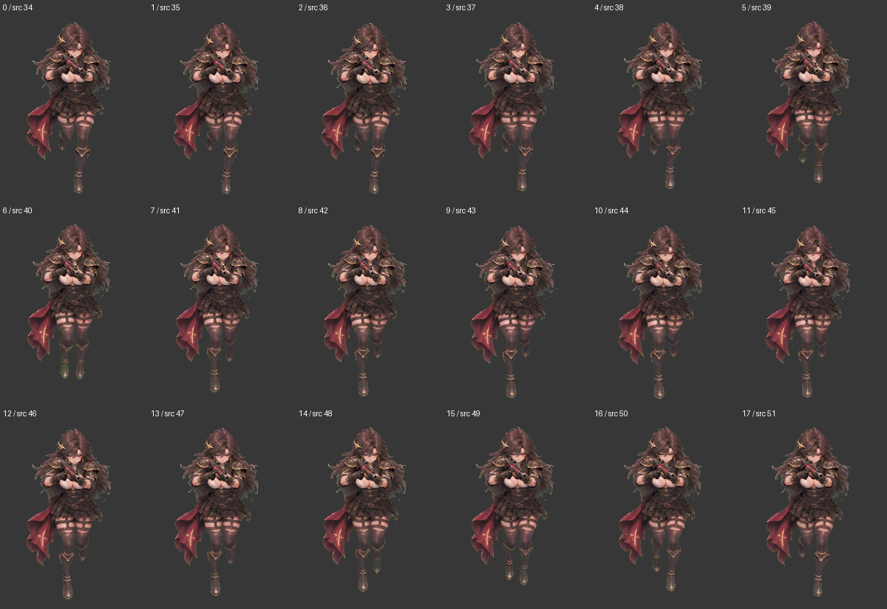

# GAME069 — 비야 S 전용 전신 조준 이동사격18장

**원화 기술 채택/납품 완료 · 게임 연결/실행 NOT_RUN · 프로듀서 최종 아트 NOT_VERIFIED.** 현재 게임은 GAME068/34클립324프레임 그대로다. 이 폴더는 선택적run_fire_s의 별도 파생 원화다. [제작세션 인계](../../../../tools/higgsfield/requests/game069/HANDOFF.md) · [실제 제작 기록](../../../../tools/higgsfield/requests/game069/README.md).

[원화 비교 영상](provenance/art_review.mp4)은 S17↔새 조준18을 동일 거리 위상/실제 표시 크기로 재생한 Pillow/ffmpeg 분석물이다. main.tscn 캡처/FPS 증거가 아니다. [반대 지지발 대조](provenance/opposite_stance_comparison.png) · [끝→첫](provenance/loop_seam.png) · [RGB/알파 비교](provenance/alpha_source_comparison.jpg).

## 원출력과 주기

Seedance2.5 두 번째 작업 **616f1112-110b-4c49-8fa8-a63dcd86d9de**, video_edit. 실제 RGB H264960×960/24fps/97장/4.041667초·음성 스트림0이다. 원본 `tools/higgsfield/requests/game069/evidence/candidate_02.mp4`의 SHA-256는 **4a402d3011dd66d1168335884dc79be3d5251e876f2bdd8604b94bb943a36aa4**.

원천0기준 **34~51 연속18장**, PTS1.416667~2.125초를 사용하고 다음 대응52/2.166667초는 제외했다. 원천 한 주기750ms를 명목660ms/기본속도 거리659.574468ms로 재생한다. 실제 PTS 기반 표시 시간은 `provenance/frame_timing.csv`에 분리했다.17/20/47장 목표를 강제하거나 동작을 보간·핑퐁·끝 복제하지 않았다.

첫 작업 dd0d9d9c-f400-4948-a7ed-3ea9ae98b888은 허리 휴대97장 전체라 원화 채택을 거절했다. 원본 SHA-256 **988165ac9e1e5353ecae0174d5a0d94b173a28d0e5e7cbc4d81faa787f374450**와 반려 사유를 보존하며 두 번째의 입력 영상으로만 재사용했다. 두 번째는 실제 견착 자세로 바뀌었고 기존 일반 달리기의 파일명 교체가 아니다.

## 등록·알파·계측

- RGBA200×248, 표시69×85.56, 공통pivot/root(100,248). 모든 원천 프레임에 **scale0.273, translation(-31.04,-8.2)** 하나만 적용했다. 프레임별 알파 bbox 바닥 정렬/팔다리 변형은 없다.
- 서비스RGB의 녹색/청록 혼합 경계를 로컬 키로 분리했다. 불투명 내부를 유지하고 가장자리 혼합색은 인접 실제 색으로 복원했다. `prepare_game069.py`의 정확한 절차/설정을 보존한다. 서비스네이티브알파나 유료배경제거가 아니다. 흑/백/회색 전체18장과 원본의 머리·총·장화·천/내부장식을 직접 대조했다. 테두리 알파0/캔버스 절단0, PNG18개·시간표의 격리 재현 바이트 일치다.
- 각 프레임 총열 구멍 중심18개를 독립 측정하고 확대/오버레이를 검수했다. `muzzle_coordinates.csv`, 단위는200×248픽셀·관측 불확도 약1.5px다. 총 원근 때문에 S17의 대각선 총구와 크게 다르다.
- `foot_landmarks.csv`는 실제 각 장화 끝/지지·회복 상태다. S17의 우지지11↔새1, 좌지지3↔새10을 직접 맞춰 새위상 **0.8510092121212124**를 독립 산출했다. 두 앵커 최대잔차0.014706주기다. S17위상0.4572192098143875를 복사하지 않았다. 2D투영 자세 대응이며 물리 바닥/무미끄러짐 증명이 아니다.

[시간표](provenance/frame_timing.csv) · [총구](provenance/muzzle_coordinates.csv) · [장화](provenance/foot_landmarks.csv) · [위상](provenance/phase_alignment.json) · [클립 메타데이터](provenance/clip_metadata.json) · [등록](provenance/source_registration.json) · [QA/한계](provenance/qa_report.json) · [해시](CHECKSUMS.sha256).

## 판단과 남은 범위

S 고각 정면·성인 비야/갈색 웨이브·기존 의상/붉은 천 비대칭을 유지하며 양손/어깨가 총기를 지지한다. 양발이 교대하고 골반·몸 높이/어깨·머리/천이 연속적으로 움직인다. 선택 주기에서 섬광/탄환/탄피·신규 인물/장비나 방향 회전은 관찰되지 않았다. 마지막51→34는 다음52를 복제하지 않고 이어진다. 수치/해시 차이만으로 채택한 것이 아니다.

휴대↔조준의 상체 윤곽 변화와 일부 발 위치 차이는 남는다. 미세 머리카락·작은 룬/문양의 픽셀 동일성, 가려진 총기 실물 길이/3D구조는 보장하지 않는다. 정면 단축 원근과 전체 자연스러움의 최종 판단은 프로듀서에게 남긴다. 실제 발사/반동1:1동기화·엔진 전환/실기/FPS는 수행하지 않았다.

유료2건/최대2건·견적28+31/실차감59·한도60/남은1, 실제 계정629→601→570이다. 추가결제/충전·유료추가출력0이며 GAME068의남은32를 사용하지 않았다. 모든 비용/입력/작업/설정은 제작 기록에 있다.

제작세션은 기존34클립/324프레임 전부와 원본208/ARTFIX001/GAME064~068/SAVEFIX001을 보존하고 run_fire_s18만 추가한다. 예상35클립/342프레임이며 누락/무효 시 같은 거리 위상run_s17로 복귀한다. 기존 저장/전투규칙을 바꾸지 않는다.

재현: `python3 tools/higgsfield/prepare_game069.py --video tools/higgsfield/requests/game069/evidence/candidate_02.mp4 --out <격리출력> --decoded-dir <격리캐시> --start 34 --end 52 --scale 0.273 --tx -31.04 --ty -8.2`. 계측/분석은 `measure_game069.py`·`preview_game069.py`를 사용했다.
