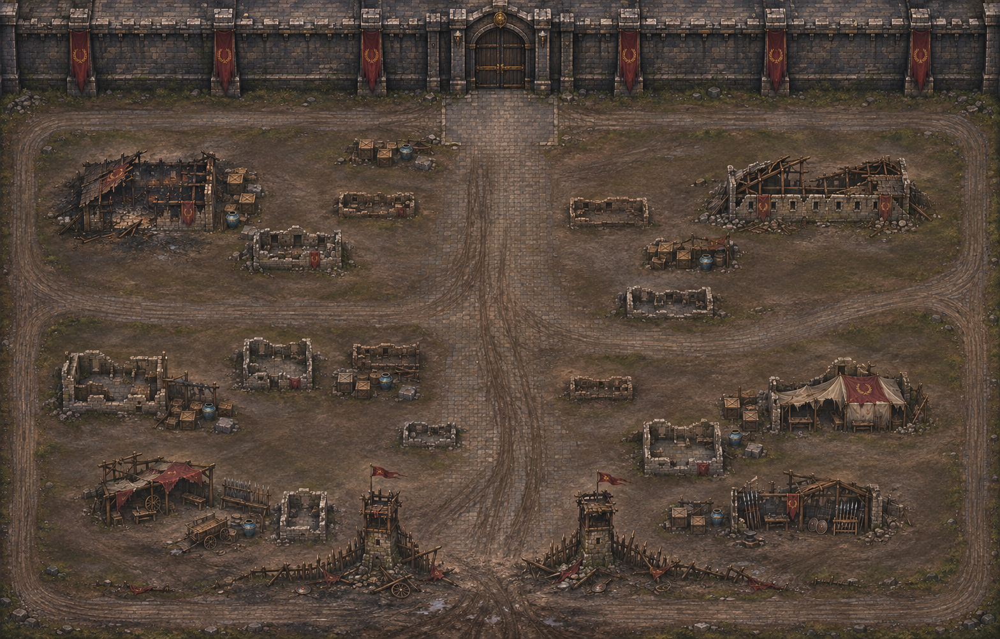
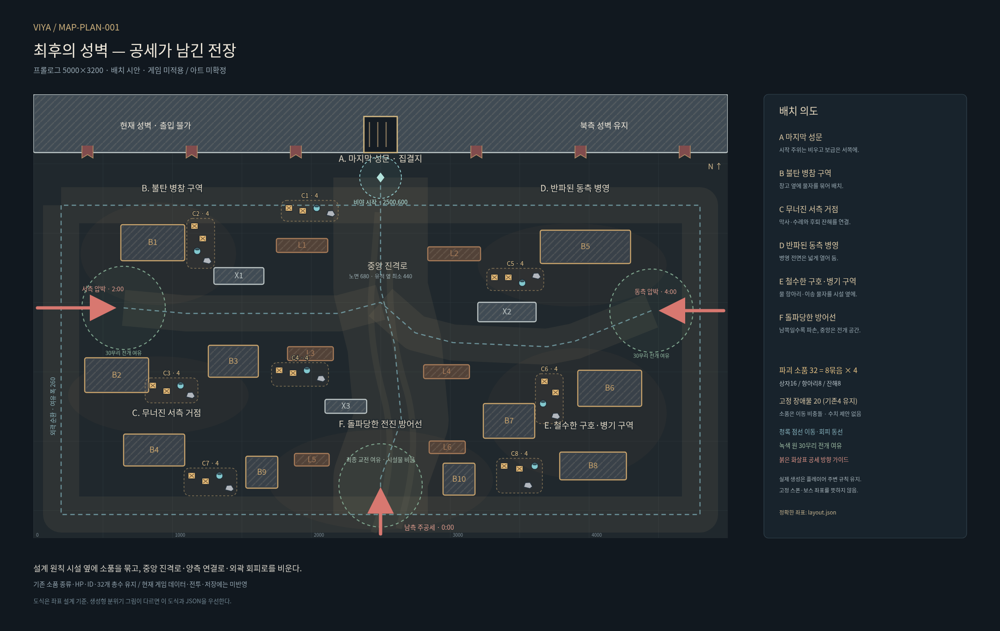

# MAP-PLAN-001 — 최후의 성벽: 공세가 남긴 전장

**후속 적용 안내 — GAME-049:** 사용자가 대상을 정정해 이 배치를 **프롤로그가 아닌 별도 1스테이지 `siege_battlefield`**에 연결했다. 프롤로그 원본은 유지한다. [현재 실제 렌더](../../validation/GAME049_OVERVIEW.png) · [검증](../../validation/GAME049_REPORT.json). 아래 JSON/SVG/HTML·검증은 원래 시안 작성 시점의 기록이며,프롤로그/게임 미적용 표기는 당시 상태다. 아트는 여전히 미확정이다.

**원래 시안 작성 기록: 배치 제안 / 당시 게임 미적용 / 아트 미확정.** 2026-11-24 KST. 사용자 요청은 무작위처럼 보이는 구조물 배치를 전장으로 읽히게 만드는 전체 맵 시안이다. 현재 프롤로그 `prologue_wall`의 5000×3200을 기준으로 작성했다. GAME-049 구현이나 최종 아트 승인으로 계산하지 않는다.

[전체 배치도 PNG](layout.png) · [확대 가능한 SVG](layout.svg) · [인터랙티브 배치도](preview.html) · [정확한 좌표 JSON](layout.json)

위 그림은 생성형 **배치·재질 분위기 제안**이다. 그림 속 상자/작은 폐허 수는 정확한 구현 수량이 아니며, 남측 목책도 도식의 탈출 간격을 우선해 끊어야 한다. 망루/지붕의 가림은 적용 시 검토한다. 정확한 배치는 아래 도식과 JSON이 기준이다. [그림 원본](concept.png) · [생성 출처·차이점](concept_provenance.json)

## 공간의 이야기

북쪽에는 아직 버티는 성벽과 닫힌 성문이 있고, 그 앞에 마지막 보급품이 남아 있다. 남쪽으로 내려갈수록 불탄 시설, 철수 물자, 끊긴 방책과 무너진 망루가 나타난다. 적이 돌파한 방향을 흔적으로 보여주고, 건물은 양측에 모아 중앙 전투 공간을 확보한다.

| 구역 | 시설과 배치 이유 | 파괴 소품 묶음 |
| --- | --- | --- |
| A 마지막 성문·집결지 | 성문과 시작점 유지. 시작 주변을 비우고 서쪽 보급 수레 자리에 물자를 모음 | C1 성문 보급 수레 |
| B 불탄 병참 구역 | 창고 출고면에 상자·항아리. 창고에서 성문으로 향하던 보급 동선 | C2 창고 출고 물자 |
| C 무너진 서측 거점 | 경비막사·숙영동·수레 정비소. 측면 공세에 무너진 거점과 철수 흔적 | C3 막사 철수 장비, C7 전진 수레 잔해 |
| D 반파된 동측 병영 | 병영 외벽 뒤로 시설을 모으고, 전면 집결 공간은 넓게 열어 둠 | C5 병영 보급 묶음 |
| E 철수한 구호·병기 구역 | 구호소 주변 물 항아리, 병기터 주변 파편·장비. 시설 용도와 소품 연결 | C6 구호소 이송 물자, C8 병기터 파편 묶음 |
| F 돌파당한 전진 방어선 | 끊긴 방책 6개와 남측 망루 2개. 남쪽의 파손을 강조하고 중앙 교전 공간은 비움 | C4 방책 후퇴 잔해 |

각 묶음은 기존 상자 2·항아리 1·잔해 1의 4개다. 총 **32개 = 상자16·항아리8·잔해8**이며, 모두 시설·수레·철수 흔적과 함께 배치한다. 개별 좌표와 원래 순서·ID·HP의 대응은 `layout.json`에 들어 있다. 이 제안의 수레·방책·망루·시설 이름은 환경 연출용이며 새 상점·치료소·퀘스트 기능을 뜻하지 않는다.

## 전투 동선과 가독성

- 중앙 진격·후퇴로: 북쪽 시작점부터 남측 전개 공간까지 연속. 시각적 노면 폭 약680, 기존 폐허 옆은 약440으로 좁혀 유지한다.
- 외곽 순환로와 양측 연결로: 반경130의 중심선 여유, 즉 폭260의 연속 통과 띠를 확인했다. 골목을 막다른 길로 만들지 않는다.
- 30마리 무리 전개 공간: 남측 `(2500,2820)`, 서측 `(650,1540)`, 동측 `(4450,1560)`에 반경300의 여유를 확보했다. 고정 생성 위치가 아니라 장애물을 비우는 기준이다.
- 기존 성벽·폐허 4개를 보존하고 시설10개·끊긴 방책6개를 제안했다. 성벽 아래 면적 중 고정 충돌 발자국을 제외한 비율은 약90.59%다. 건물 내부를 탐색하는 별도 맵은 만들지 않는다.
- 파괴 소품은 기존처럼 이동 비충돌이다. 시각 잔해도 이동 가능한 바닥과 구분하고, 통과 가능한 곳을 큰 파편으로 막혀 보이게 그리지 않는다.

노면은 기존 회색 석재를 기본으로 하고, 남쪽에만 진흙 수레 자국·탄 흔적·부러진 방패/창·찢어진 진홍 깃발을 더한다. 낮은 채도와 작은 장식을 사용해 XP·금화·회복 아이템·적 공격 예고와 경쟁하지 않게 한다. 상시 붉은 마법진, 큰 연기, 긴 가림 벽과 높은 지붕은 피한다. 높은 앞면이 필요한 곳은 기존 발 기준 정렬·캐릭터 가림 완화에 맞춘 별도 검토가 필요하다.

그림의 공세 화살표는 현재 프롤로그의 정면→측면 전개를 설명한다. 실제 GAME-048은 플레이어 주변의 유효 화면 바깥 가장자리에서 생성한다. **화살표·전개 원·최종 교전 공간은 고정 스폰·고정 보스 위치·체크포인트 건물이 아니다.** 시간 체크포인트 2·4분은 유지 대상이다.

## 현재 게임과 적용 시 검토할 부분

기준 문서 HEAD `84c9718d9c71ff410749975d76d6d1b773fa7570`, 실제 GAME-048 코드 `85ddb8282a46967bef9ec0dc54dcf903d6023729`. 현재 `data/maps.json`, `data/destructibles.json`, 씬·스크립트·런타임 자산·저장은 변경하지 않았다. 기존 성문 `(2380,160,240,260)`, 시작점 `(2500,600)`, 벽과 기존 폐허는 그대로인 제안이다. 도시 외곽·골드 던전은 설계 대상에 포함하지 않았다.

추후 게임에 적용할 때 확인할 항목:

1. 공개 저장1~20의 기존 맵 지문·좌표·소품ID/HP·아이템·45초 재생성 잔여·보상 원장을 보존하는 호환 경로를 먼저 설계한다. 기존 데이터만 덮어써 진행 중 전투를 바꾸지 않는다. 단일 RunState와7난수·입장/정산 무중복을 유지한다.
2. 기존 12종 맵 파일럿은 활용 후보이며, 승인된 파일을 복제·변형해 새 최종 아트로 간주하지 않는다. 창고/막사/구호소 실루엣, 수레·방책·망루·바닥 흔적은 필요한 후속 자산이다. 캐릭터 ART-001·GEN-005 미승인/미연결·3D 보류·지원2+2 빈칸은 그대로다.
3. 실제 두 렌더러의 충돌·탄환 차단·지상 적 우회·30무리 생성·비행 밀기, 카메라 경계·시야, 건물 가림을 Godot에서 확인한다. 순환 가능하다는 도식 검사를 실제 추격 AI 검증으로 대체하지 않는다.
4. 소품32개와 드롭20%/성공 후HP40·MP40·자석10·제거10%, 재생성45초를 보존하더라도, 집중 배치는 회복·마나·광역 파괴 회수 효율을 높일 수 있다. 시설 순회와 같은 자리 반복 파괴가 성장·생존·금화에 미치는 영향을 실제6분 플레이로 비교한다.
5. 현재 GAME-048의 난도/6분 성장·경제 OPEN을 해결했다고 보고하지 않는다. 새로운 장애물이 접근 밀도·보스 사선·회피에 주는 영향을 GAME-049 균형 작업과 함께 검토한다. 실제 Android/iOS 프레임·발열·터치/가독성 및 사람의 재미는 미검증이다.

## 시안 검증과 재현

[기하 검사](validation.json)와 [브라우저 검사](browser-check.json)는 이 시안에 한정한 PASS다. 원래 소품 종류·HP·ID/순서 대응32개, 기존 충돌4개 유지, 소품 간 최소98.49, 중심선 여유130의4개 동선, 50단위 격자상 주요10지점 연결, 30개체 진형의 반경297.095 공간을 확인했다. 고정 장애물20개·파괴 소품32개는 실제 엔진에 배치하지 않았다.

Chromium에서 PNG 출력을 확인하고 시설 선택·레이어 비교·공세 방향·확대/복귀·JSON 다운로드와390px 반응형 화면을 실행했다. **Godot 신규 실행·모바일 실기 검증은 이번 문서 작업에서 실행하지 않았다.** 이전 GAME-048 엔진 PASS는 기존 소스에 대한 기록이다.

저장소 루트에서 `python docs/design/map_plan_001/build_plan.py`로 JSON/SVG/HTML/기하 검사를 재생성할 수 있다. 기준 데이터 해시가 달라지면 중단한다. PNG·브라우저 검사는 Playwright와 `/usr/bin/chromium`, 한글 Noto 폰트가 있는 환경에서 `python docs/design/map_plan_001/verify_preview.py`로 실행한다. 이 명령은 자체 로컬 HTTP 미리보기를 사용하며 게임 파일이나 서비스를 변경하지 않는다.

생성형 분위기 그림을 별도로 볼 경우, 정확한 건물 수·충돌·소품 좌표는 **도식과 `layout.json`을 우선**한다. 그림은 배치·재질 분위기 검토용이며 최종 아트나 즉시 사용할 게임 배경이 아니다.
