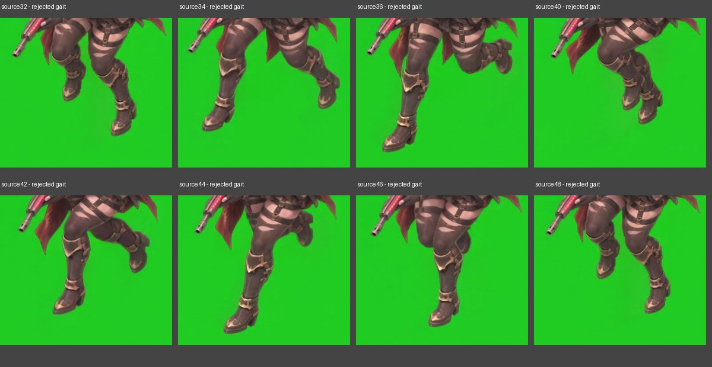

# GAME070 — SW 일반 달리기 검수 결과 / 두 후보 미채택

2026-11-27(KST), 브랜치 `work/viya-turnaround-qa-20261117`, 출발bea55a1·기존 게임 구현9fe051c. **생성2건 완료 / 기술 채택0 / 교체용RGBA·클립 납품0 / 게임 연결·실행 NOT_RUN / 최종 아트 NOT_VERIFIED**다. 기존35클립·342프레임과SW11을 유지한다.

## 입력과 변경
SW11/대기·S17 실제 영상과 현재 모션을 직접 확인했다. SW00은 화면왼쪽 가까운 다리가 펴지고 SW08은 반대 다리가 펴지는 자료여서 선택했다. 두 원화 모두 동일한4배 확대/이동(100,124)으로1000×1240 녹색 캔버스에 여백을 추가했다. 원본 인체나 비대칭은 바꾸지 않았다. S17·E/SE 영상은 생성 입력으로 넣지 않았다.

현재 Seedance2.5 스키마/역할·4초/720p/음성 끄기/후보1개·가격/잔액을 실제 조회했다. 첫 제출은SW00 start_image+SW08 image_reference. 두 번째는 같은 두 업로드를 image_reference로만 사용해 시작 자세 고정을 풀고, 양다리의 연속 회복·지지/균형을 추가 지시했다. 실제 요청·변경 근거·견적은 evidence에 보존한다.

| 후보 | 작업ID | 실제 결과 | 판단 |
| --- | --- | --- | --- |
| 1 | b2409d39-ee7b-4c2a-95f5-686e3387dd4c | RGB864×1072·24fps97장·4.041667초·음성0 | 다리 편중/급한 자세 교체로 반려 |
| 2 | f432ca21-8f98-4f45-903b-5a4aa9afa821 | RGB1280×720·24fps97장·4.041667초·음성0 | 같은 가까운 다리가 추가로 차이는 반복이 남아 반려 |

두 영상 각각97장을 순서대로 보고, 두 번째는 하나의 고정 확대 영역으로도 전부 대조했다. 첫 가운데38~49/12장 시험에서도43→44의 접힌 다리/지지발 급변이 남았다. 두 번째는 예를 들어32의먼다리지지→34~38의가까운다리지지→39~41의가까운다리회복→42~46에서같은가까운다리지지재발→48의먼다리지지로 이어진다. 두발의 번갈아 지지가 고르지 않고, 단순 구간 선택으로 정상 전신 한 주기와 자연스러운 끝→첫을 함께 확보하지 못했다. 픽셀해시/색 차이만으로 채택하지 않았다.

SW시점/성인 외형·비대칭과 양손 낮은 휴대 자세는 재사용 가능한 자료다. 시작 이미지 고정이 원인이라는 첫 추정은 두 번째에서 해결되지 않아 확정 원인으로 삼지 않는다. 잘못된 보행을 핑퐁/끝복제·사지조립·가짜보간/변형으로 고치지 않았다. 정상 주기가 없으므로 최종200×248 RGBA/660ms 게임 시간표·독립 총구/위상을 꾸며 납품하지 않는다. 원천97장 시간CSV는 각 review_01/02에 있다.

## 비용과 보존
유료 **2/최대2건**, 견적28+28·실차감 **56/한도60**, 남은작업예산 **4크레딧**. 현재 계정잔액은570→542→514/완료뒤514다. 기존GAME069잔여1은 사용하지 않았다. 추가유료출력·업스케일/연장/배경분리/음성/참조이미지 생성·새결제/자동충전/요금제변경0이다. 최대제출수에 도달해 세 번째는 하지 않는다. 두작업은모두completed이며 관측환불은없다.

원본MP4 두 개·SHA-256, 원천시간표/전체검토·결함확대, 원본/가공입력·해시/역할, 모델/설정/작업/견적/잔액·판단을 원본포함 검토ZIP에 보존한다. 저장소의 ARCHIVE.json이 영구 다운로드 위치와 ZIP해시/구성을 가리킨다. ZIP 안에서는 tools/higgsfield/requests/game070/evidence/candidate_01.mp4 및 candidate_02.mp4로 보존되며, 저장소에서는 대용량 원본을 이 패키지로 연결한다.

로컬 작업환경은 첫 결과 검수 중 transport disconnected로 사용 불가가 됐다. 이후 검수/원본 패키징은 연결된 Higgsfield 작업공간, 원격 보존은 GitHub 커넥터로 수행했다. 게임 실행/연결로 계산하지 않는다. 환경 단절 전에 기존assets/scripts/data1,526개가 출발bea55a1과 동일함을 확인했고, 최종 저장소는 기존 게임 자산/코드/데이터를 건드리지 않는 검토 기록이다.

다음은 이 반려 자료와 올바른 반대 지지발 참조/입력 전략을 검토하는 한 단위다. 기존 예산으로 자동 재생성하거나 제작세션에 연결을 지시하지 않는다. 제작세션은SW11·다른34클립331·원본208/ARTFIX001/GAME064~069/SAVEFIX001·저장22/7난수/스폰/AI/피해/HP/MP/보상/속도를 보존한다. SW 이동사격/다른방향/적/초상화는 별도다. main병합/force push/유료Actions0·3D보류·지원2+2빈칸을 유지한다.

[원본 포함 검토ZIP 다운로드](https://d2ol7oe51mr4n9.cloudfront.net/user_3LHdo37hN3iiYXd8WT9stnWXw4M/4caa9f09-a185-4d85-ae5c-efeab56c94e3.zip) · [ZIP 해시/구성](ARCHIVE.json)

