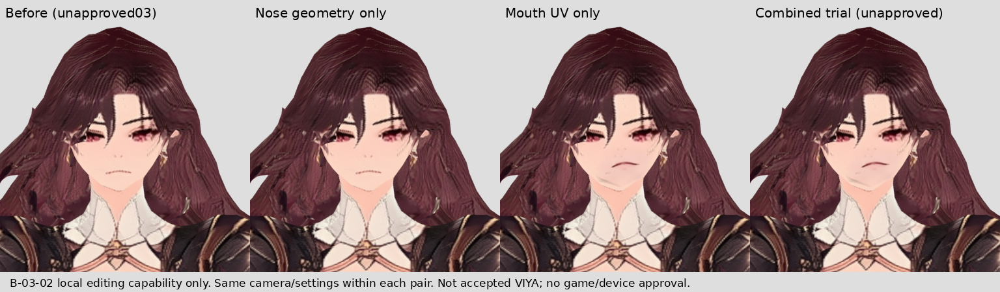
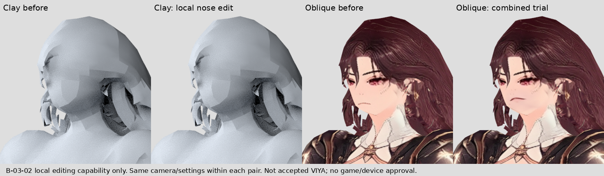

# 플랜B B-03-02 — 얼굴 국소 형태·입선 UV 실제 편집 시험

2026-11-28 KST · 기획·아트 · **국소 편집/저장·재개방 시험 완료 / 최종 얼굴 제작·승인 전**.

실제 Blender4.3.2에서 미승인 후보03을 격리 진단 표본으로만 연결했다. 폐기01/02를 불러오지 않았고03을 생산용 몸/얼굴로 채택하지 않았다. 새 생성·리깅/동작·게임 적용은0이다. [B-03-01 원본4장 기준안](../face_reference_v1/README.md)을 이어 사용하며 이번에는 코의 국소 형상과 입선 UV 배치 두 가지의 편집 가능성만 시험했다.

## 실제 결과와 남은 한계

| 시험 | 실제 수행/확인 | 판정 범위 |
| --- | --- | --- |
| 형태 | 기존 실제 얼굴의32개 정점에 되돌릴 수 있는 코 돌출 Shape Key를 추가했다. 명목 상한3mm, 실제 정점 최대변위 약2.687mm다. Basis 좌표와 원래UV/토폴로지는 유지했다. | 국소3D 편집 가능. 원화와 같은 코/두개골을 완성한 것이 아님 |
| 입선 UV | 정면 원본의 발췌 픽셀을 그대로 사용해 입 주변76개 정점에 새UV/부드러운 재질 혼합 영역을 마련했다. 원래UV/전체 텍스처는 보존하고 스위치로 끌 수 있다. | 입 그림 배치 가능. 눈·전체 얼굴 수정/전방향 텍스처 정합을 입증한 것은 아님 |
| 저장/재개방 | 새.blend를 저장하고 별도의 Blender 프로세스에서 열어12개 상태 항목과32개 실제 변위/범위를 대조했다. 재개방 뒤 렌더 픽셀도 저장 전과 같았다. | 파일 영속성/의존 참조 확인. 게임/실기 실행 증거가 아님 |
| 외형 품질 | 정면의 입선은 바꿀 수 있었으나 얼굴의 평면적인 형태·눈/턱·머리카락과 경계 차이는 남는다. | **정식 얼굴/캐릭터로 미채택**. 부분 입선 변경을 얼굴 왜곡 전체 해결로 보고하지 않음 |

같은 비교 쌍은 같은 카메라/등록·조명/재질 설정으로 렌더했다. 색 비교는 원본색 emission으로, 기하는 무채색으로 분리했다. 작은 코의 Y방향 이동은 정면 색 영상에서 거의 읽히지 않아 무채색 사선과 실제 정점 변위를 함께 확인했다. 픽셀 변화/해시 차이를 닮음이나 개선 정도의 수치로 쓰지 않는다. 사선의 입선 배치는 시험했지만 완전 측면/게임55도·실제 표시 크기의 최종 외형 검수는 아직 아니다.

## 파일과 편집 방법

- [편집 시험본](face_edit_trial.blend): 진단 표본의 로컬 메시/Shape Key·원본UV/새 입선UV/혼합 제어, 비교용 카메라와 재질이 있다. 게임 임포트는 폴더 `.gdignore`로 제외했다.
- 시험본은 기존 [후보03 검수.blend](../../../../../../assets/characters/plan_b_viya/candidate_03/review/viya_body_review.blend)를 상대경로 라이브러리로 참조한다. **이 의존 파일을 함께 유지**해야 원본 텍스처를 재개방할 수 있다. 휴대 가능한 최종 자산 납품본이 아니다.
- 오브젝트 `DIAGNOSTIC_ONLY_FaceEditTrial`의 Shape Key `TEST_NoseProjection_3mm`를0/1로 바꿔 형태 전후를 본다. 재질 `FaceTrial_TextureOnly`의 `UV_trial_enabled`를0/1로 바꿔 입선 배치를 비교한다. 얼굴 승인 전 본게임 자산으로 사용하지 않는다.
- [원본 발췌](source_face_crop.png)는 정면 원본(665,115)~(875,290)의210×175 무손실 발췌다. 얼굴 복원·재생성·페인트/미러·AI 확대를 하지 않았다. 검수용 발췌/3D 텍스처 연결과 새 원화 제작을 구분한다.
- [실행/변경 범위·입력 SHA](build_result.json), [별도 프로세스 재개방](reopen_result.json), [렌더 픽셀 비교](pixel_comparison.json), [전체 체크섬](CHECKSUMS.sha256).

원본의2D 관찰점을 실제3D 치수로 환산한 것이 아니다. UV는 입선 배치 방법을 시험하는 수동 등록(`source_x=770+(x+.004)*1250`, `source_y=178-(z-1.590)*1420`)이며 새로운 얼굴/표정 기준 승인으로 승격하지 않는다. 기존2D 동작을 잘라 조립하거나 프레임별 워핑으로 보행을 만든 작업도 아니다.

## 재현과 실제 검증 범위

1. 위210×175 원본 발췌를 유지한다. [run_trial.py](run_trial.py)는 원본GLB/정면 이미지SHA를 먼저 확인한다.
2. `blender -b --python tools/higgsfield/requests/plan_b/b03/face_edit_trial_v1/run_trial.py -- build`
3. 다른 프로세스로 `blender -b --python tools/higgsfield/requests/plan_b/b03/face_edit_trial_v1/run_trial.py -- verify`
4. `python tools/higgsfield/requests/plan_b/b03/face_edit_trial_v1/make_review.py`로 발췌 동일성·재개방 렌더 동일성, 분리 렌더의 실제 변경과 비교 자료/체크섬을 확인한다.

Blender4.3.2/Cycles16샘플·seed7/384×384/정사영0.30m·Standard/denoise off에서 실제 수행했다. 현재 설치 빌드는 denoiser를 제공하지 않는다. 픽셀 동일성은 이 고정 시험 환경에서의 결과다. 무채색 차이에는 표면 변화에 따른 렌더 음영 영향이 있으므로 차이 영역 전체를 실제 정점 변형 영역으로 부르지 않는다. 정점32개/최대변위와 원본 보존은 별도로 검사했다.

현재 Blender 공식 Mesh API의 검색 자료는 정점과 폴리곤·UV loop의 분리를 설명한다: [공식 Mesh API](https://docs.blender.org/api/current/bpy.types.Mesh.html). 버전별 온라인 본문 조회가 되지 않아4.3.2 지원 여부는 위 실제 실행·재개방으로 확인했다. API 문서나 기능 존재만으로 실제 얼굴 제작 성공을 주장하지 않는다.

## 판정과 다음 작업

**B-03-02의 국소 편집 경로 시험은 완료**했다. 전체 원화 얼굴 제작 능력/최종 품질이 입증됐다는 의미가 아니다. 다음은 B-03-03에서 원본4장의 정면·양측면과 맞는 단순하고 편집 가능한 머리 형태를 작은 범위로 제작/검수하는 것이다. 시험03의 몸/머리를 자동으로 정식 기반으로 채택하거나 전신 재생성·리깅으로 건너뛰지 않는다. 머리 형태를 확보한 뒤04 전체 얼굴UV/색,05 얼굴 판단 순서를 따른다.

이번 유료 제출/실차감0·잔액 재조회 없음. 이전3건100/마지막 관측297은 과거 이력이다. 원본4장·후보03 원출력/기존 검수 원본·기존2D36클립363·임시3D/게임 코드/전투·저장 규칙은 그대로다. B-03진행·전체완료1/8, 제작세션 정식 자산 대기·엔진/Windows/S20+·최종 아트 승인 전을 유지한다.
