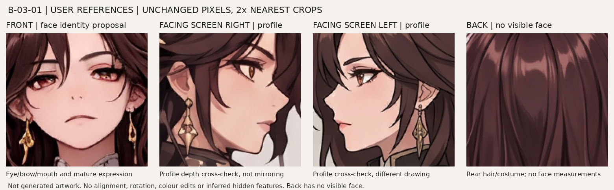
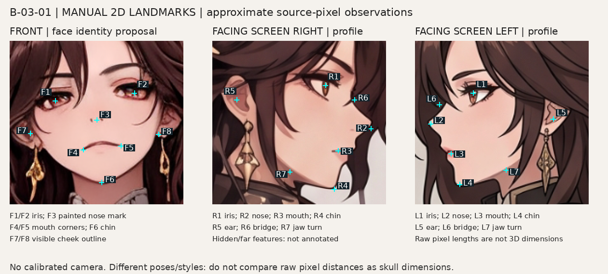

# 플랜B B-03-01 — 원본 4장 얼굴 기준·불일치 정리

2026-11-28 KST · 기획·아트 · **참조 분석 자료 준비 완료 / 얼굴 제작·프로듀서 승인 전**.

이 자료는 [제작 순서103절](../../../../../../docs/PLANNED_WORK.md)의 첫 내부 단계다. 새 캐릭터·얼굴·모델 생성이 아니며 전체 플랜B는1/8, B-03 진행을 유지한다. 후보01/02는 폐기·재사용 금지,03은 미승인 진단용이다. 여기서는 생성 모델/텍스처가 아니라 사용자가 제시한 원본4장만 분석했다.

## 실제 확인 자료

네 원본을 직접 열어 전신과 얼굴을 확인했다. 원본 픽셀은 변경하지 않았고 검수 이미지는 직사각형 발췌·2배 최근접 확대와 글자/측정점 표시만 수행했다. 얼굴 복원·미러·회전·워핑·AI 보간·색 수정은 없다. 발췌는 원본의 일부를 보여 주는 검수 자료이며 서비스에 제출할 새 시작 이미지나 정합 도면이 아니다.

| 원본 | 원본 크기 | 검수/제작에서의 역할 | 한계 |
| --- | --- | --- | --- |
| [정면](../../../../../../assets/characters/plan_b_viya/candidate_03/references/front.png) |1536×2048 | **주 얼굴 기준안**: 성숙한 인상·눈/눈썹/입선·정면 비율 | 기울어진 눈높이·앞머리 가림과 그림의 원근을 그대로3D 골격 비대칭으로 옮기지 않음 |
| [화면 오른쪽을 보는 측면](../../../../../../assets/characters/plan_b_viya/candidate_03/references/screen_right_profile.png) |1529×2048 | 코·입·턱의 돌출과 윤곽 대조 | 반대 측면과 그려진 아래 얼굴·장식이 다름. 파일명은 해부학적 좌/우 보증이 아님 |
| [화면 왼쪽을 보는 측면](../../../../../../assets/characters/plan_b_viya/candidate_03/references/screen_left_profile.png) |1529×2048 | 반대 방향 코·턱/귀·머리 윤곽 대조 | 얼굴과 어깨·코르셋·장화의 표현 차이. 반전시켜 정합했다고 하지 않음 |
| [후면](../../../../../../assets/characters/plan_b_viya/candidate_03/references/back.png) |1529×2048 | 뒤 머리·천·복장 연결 확인 | 얼굴이 보이지 않아 얼굴 형태의 근거로 쓰지 않음 |

원본SHA-256/크기·발췌 좌표·역할은 [face_landmarks.json](face_landmarks.json)에 기록했다. 기존4장 보유/해시 확인을 새 생성 성과로 계산하지 않는다. ART-001의 기록된 정확한 원본 파일은 앞선 감사에서 미확보이며 이번4장으로 그 출처를 대체하지 않는다.

## 얼굴 제작 기준안

- **유지**: 성인 비야의 차분하고 성숙한 인상, 길고 가늘게 이어진 눈/눈썹, 원본 홍채색·작은 코 표현·닫힌 입선·턱 윤곽, 짙은 갈색 웨이브와 기존 앞머리 방향. 큰 둥근 유아형 눈/볼, 과장된 미소, 넓어진 코·입과 붉은 머리로 재해석하지 않는다.
- **역할 분리**: 정면의 얼굴 인상과 특징을 주 기준으로 쓰고 양측면에서 코/입/턱의 깊이와 실루엣을 교차 확인한다. 정면의 작은 코 그림을 납작한 얼굴 구조로 옮기거나 측면 한 장의 선을 나머지 얼굴에 강제로 붙이지 않는다.
- **가림 구분**: 앞머리 아래 중심 헤어라인/가려진 귀와 반대쪽 눈은 관찰 불가다. 임의 좌표를 측정값으로 적지 않는다. 보이는 앞머리·귀걸이 방향과 머리 볼륨은 유지한다.
- **간단한 얼굴 허용**: 정확한 단순 머리 형태와 잘 배치된 애니풍 눈/입 텍스처도 가능하다. 이 자료는 복잡한 실사 조각·표정 리그를 요구하지 않는다. 형태/텍스처 수정 능력은 다음 단계에서 실제로 시험한다.
- **승인 상태**: 위 내용은 후속 제작용 기준안이다. 새 얼굴 형상/텍스처 승인이나 후보03의 얼굴 수용이 아니다. 비용 없는 방법 시험을 먼저 진행하고 얼굴 결과는 B-03-05에서 프로듀서가 판단한다.

## 관찰 좌표와 해석 범위

[CSV](face_landmarks.csv)와 JSON에 총22개의 수동2D 관찰점을 남겼다. 원본 좌상단(0,0), x오른쪽/y아래, 단위px다. F=정면, R=화면오른쪽을 보는 측면, L=화면왼쪽을 보는 측면이다. 홍채 중심/코 그림 또는 코끝/입선·턱·볼·귀·콧등을 구분했고 관찰 오차도 표시했다. 오차는 수동 표시의 대략값이며 합격 허용오차나 해부학 측정의 신뢰구간이 아니다.

정면 F1/F2의 눈높이가 다르고 양측면의 아래 얼굴 투영/선이 다르게 보인다. 카메라·머리 기울기·그림체가 보정된 도면이 아니므로 원본px 길이를 서로 나눠3D 두개골 치수를 확정하거나 외형 불일치를 수치 하나로 판정하지 않는다. 정면의 코 표시는 깊이를 측정한 코끝이 아니다. 헤어라인의 가려진 부분은 별도 `not_measurable`에 남겼다.

## 실제 불일치와 정리안

전체 항목은 [conflict_matrix.csv](conflict_matrix.csv)의12개 항목이다. 핵심은 다음과 같다.

| 확인한 차이 | 이번 정리안과 후속 확인 |
| --- | --- |
| 정면은 음영/눈꺼풀 표현이 세밀하고 측면은 더 평면적인 선·음영이다. | 정면 얼굴 인상 중심으로 한 스타일을 만들고 같은 머리를 양측/고각으로 돌려 확인한다. 네 그림의 표면 표현을 평균내지 않는다. |
| 양측면에서 코·입·턱 윤곽/아래 얼굴의 길게 보이는 정도가 다르다. | 원근과 머리 자세 영향을 구분하며 한 개 머리의 정면·양측면을 검수한다. 차이를 그대로 비대칭 두개골로 만들지 않는다. |
| 정면/후면은 팔을 벌리고 측면은 팔을 내렸다. | 같은 포즈의 정밀 다방향 자료라고 취급하지 않는다. 외형 참조와 뼈대 기본 포즈를 분리한다. |
| 어깨 금 장식·코르셋 고리/벨트·장화 뒤축과 천의 길이/배치가 다르다. | 앞/뒤 구조 중심의 일관된 의상 정리안을 만들되 시점/가림에 의한 차이도 구분한다. 어느 측면이 어느 신체 측면인지 파일명만으로 결정하거나 반전하지 않는다. B-03-07에서 전신 확인한다. |
| 네 장 모두 총기가 없다. | B-03-06 이전에 기존 승인 룬 총기의 별도 참조를 사용한다. 이 네 장으로 새 총기를 추측해 만들지 않는다. |

이 불일치는 입력 정리 필요성의 근거다. 후보03 얼굴 실패의 유일한 원인이4장 차이라고 입증한 것은 아니다. 자동 복원 과정의 얼굴 형상/텍스처 손실과 함께 검토해야 한다.

## 다음 B-03-02에 넘기는 작업

1. 이 기준안과 관찰점으로 얼굴 형태/UV를 독립 수정할 수 있는 비용 없는 작은 실제 편집 시험을 준비한다. 폐기01/02를 불러오거나 후보03을 승인 기반으로 승격하지 않는다.
2. 수정 전/후를 같은 시점·조명에서 제시하고 저장/재개방까지 확인한다. 도구 설치나 단순 도형 제작을 얼굴 수정 능력의 입증으로 계산하지 않는다.
3. 가능한 방법과 남은 한계를 기록한 뒤03 머리 형태 작업으로 이어간다. 방법이 없으면 필요한 기능/전문 작업을 구체적으로 알리고 차단 사유를 남긴다.
4. 새 유료 제출·리깅·게임 적용은 이번 자료 준비에 포함하지 않는다. 제작세션의 정식 자산 대기는 유지한다.

## 비용·재현·현재 상태

- 이번 새 제출0/실차감0. 잔액은 재조회하지 않았다. 이전3건100·마지막 관측297은 과거 이력이다.
- 원본4장·모델/텍스처·기존2D36클립363·임시3D/게임 코드의 변경0. 생성물 채택/얼굴 수용·엔진/기기 검증0.
- 재현: 저장소에서 `python tools/higgsfield/requests/plan_b/b03/face_reference_v1/build_review.py`. Pillow와DejaVuSans가 필요하다. 원본4장의 해시·크기를 검증한 뒤2개 무손실 검수PNG/CSV·체크섬을 재생성한다. 폴더의 `.gdignore`로 게임 임포트에서 제외한다.
- [체크섬](CHECKSUMS.sha256) · [현재 상태](../../../../../../docs/CURRENT_WORK.md) · [기획세션 연계](../../../../../../docs/PLANNING_SESSION_HANDOFF.md).

공식 확인(2026-11-28): [Meshy 다중 이미지API](https://docs.meshy.ai/en/api/multi-image-to-3d)는 동일 물체의 다른 각도1~4장 입력을 설명하며, [얼굴/손·포즈 안내](https://help.meshy.ai/en/articles/16102152-fix-character-pose-face-and-hand-issues-in-meshy)는 스타일화된 얼굴의 형상/세부 손실과 리깅 전 정리를 설명한다. 공식API의 세부옵션/버전·얼굴 고정 기능이 현재Higgsfield도구에 노출된다는 의미가 아니며 이번은 조회/로컬 분석만 수행했다.
