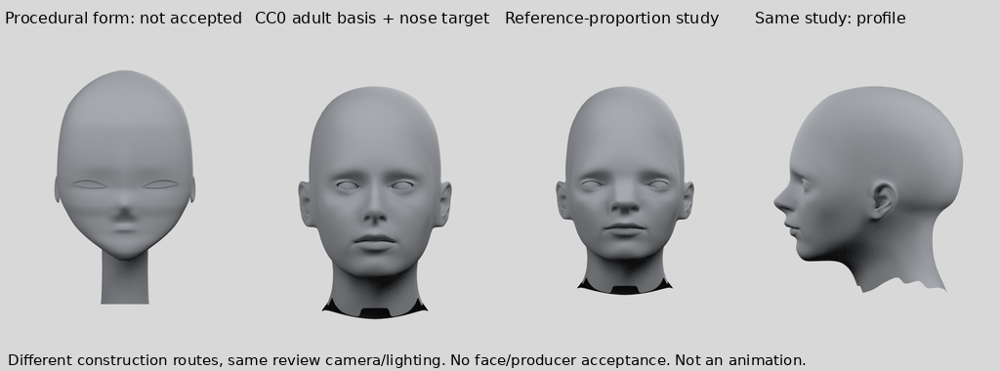
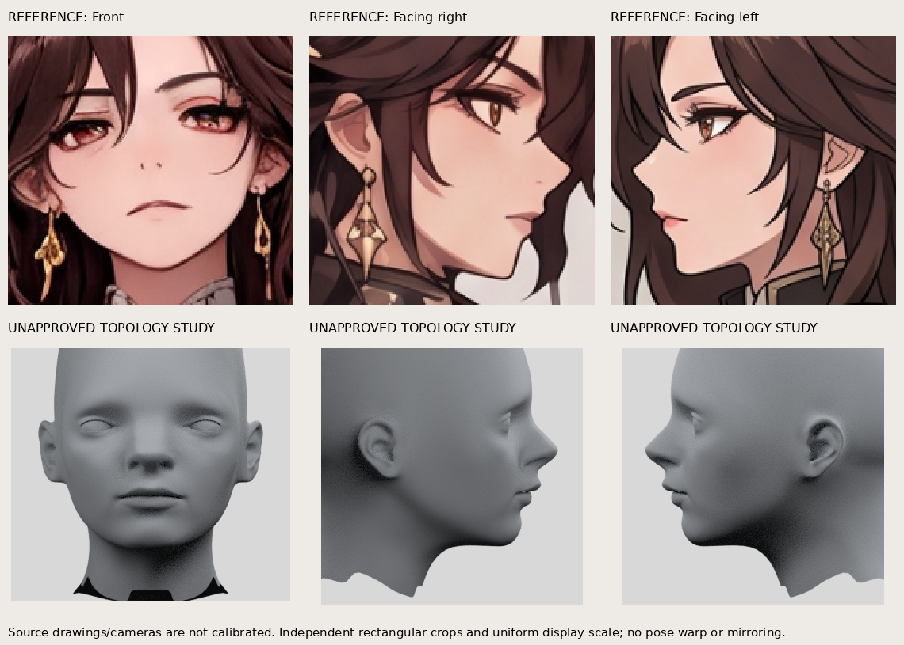
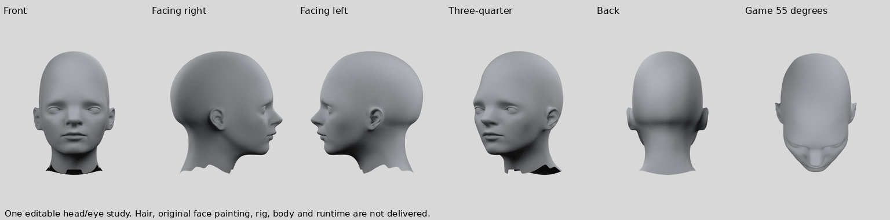

# 플랜B B-03-03 — 머리 형태/얼굴 면 구조 초안, 원화 검수 진행

2026-11-28 KST · 기획·아트 · **B-03-03 진행 / 원화 형태 검수 미통과 / 게임 미적용**.

새 머리 형태를 제작하고 정면·양측면/사선·후면/게임55도에서 검토했다. 처음 만든 절차적 곡면은 눈꺼풀·코·입 주변 구조가 부족해 생산용에 채택하지 않았다. 이후 공식 CC0 얼굴 기본 메시/변위 자료를 확보해 **머리/목과 눈 부분만** 실제로 구성했다. 새 초안도 비야의 원화 인상/형태 검수는 아직 미통과다. 원본4장과 기존 게임을 유지하고, 실패한 형태를 텍스처/전신·리그로 넘기지 않는다.

## 현재 결론

| 항목 | 실제 결과 |
| --- | --- |
| 절차적 곡면 | 폭/깊이·국소 특징으로 새 메시를 만들고 조명/코·턱/입·턱 밑면을 수정했으나 상세 얼굴 구조가 부족했다. **생산용 미채택**, 원본/로컬 수정 이력 보존 |
| 후속 구조 | MPFB의 CC0 기본 메시와 성인형 여성/코 폭 변위 자료에서 머리·눈 부분을 구성했다. 원본 바이트/라이선스·Git blob/SHA-256을 보존했으며 애드온 코드 설치/복사는 없다. |
| 편집 가능성 | 머리 피부4,311정점/4,286면 + 눈 각72정점/70면 = **4,455정점/4,426면**의 제어 메시다. 원본 정점 인덱스/UV·기본형과 되돌릴 수 있는 비율 Shape Key를 유지한다. |
| 저장/재개방 | 두 경로 모두 별도 Blender 프로세스에서 열어 좌표/토폴로지·제어를 대조했다. 사선 렌더의 픽셀도 동일했다. 구조 경로의 NaN/0면적 면은 없으며 외부.blend 라이브러리 의존0이다. |
| 원화 형태 | **미통과/보완**. 코의 콧대/콧방울·돌출이 더 사실적으로 읽히고, 눈꺼풀 개구/눈꼬리와 입술 볼륨이 주 정면 원화의 인상에 충분히 맞지 않는다. 새 기본 메시를 비야의 완성 얼굴로 승인하지 않는다. |
| 다음 | **B-03-03 유지**: 후속 면 구조에서 눈꺼풀·코·입/턱을 원본 정면·양측면과 대조해 국소 보완한다. 자체 형태 검수 전04 텍스처/05 얼굴 판단·전신/리그로 넘기지 않는다. |

위는 서로 다른 제작 경로의 검수다. 같은 메시의 단순 전후나 애니메이션으로 보지 않는다. 비교 카메라/조명은 같지만 원본 도면은 보정된3D 촬영이 아니며 닮음/품질을 픽셀 차이나 해시로 판정하지 않는다.

## 원본과 시점 검토

[B-03-01 네 원본 기준 자료](../face_reference_v1/README.md)를 이어 사용했다. 정면을 얼굴 인상의 주 기준안, 양측면을 코/입/턱 깊이·윤곽 대조, 후면을 가려진 뒤 머리/구조 확인에 사용한다. 정확한 ART-001 원본 미확보/새 얼굴 승인 전 상태는 유지한다. 가려진 두상·귀의 세부는 임시 가정이며 측정한 원화 사실로 기록하지 않는다.

위 검수 이미지는 원본과 렌더의 독립 직사각형 발췌/일정 배율 표시다. 얼굴을 보정·반전·워핑하거나 원본 얼굴을 재생성하지 않았다. 서로 다른 그림/카메라를 억지로 정합하지 않았다. 발췌 좌표와 표시 방법은 [comparison_registration.json](comparison_registration.json)에 있으며 서비스 생성 입력이나 승인된 시작 이미지가 아니다.

원화의 머리카락에 가린 두상을 그대로 검증할 수 없고, 눈동자·원화 눈/입 그림과 머리카락은 이 형태 단계에서 제작하지 않았다. 이 누락을 최종 캐릭터 디자인으로 받아들이지 않는다. 피부/눈 경계와 코/입/턱의 형태는 무채색에서도 보완해야 하며, 원화 텍스처로 구조 결함을 가리는 방법으로 통과시키지 않는다.

## 실제 파일과 재개 위치

- **후속 수정 경로**: [CC0 면 구조 시험본](cc0_topology_trial/cc0_head_topology_study.blend). `CC0_head_skin_UNAPPROVED`와 두 눈 메시, `CC0_adult_form_basis`/`VIYA_reference_proportion_STUDY` Shape Key가 있다. **비야 최종/게임용 모델이 아니다.**
- [비율/국소 제어](cc0_topology_trial/adaptation_parameters.json), [입력/메시·실행](cc0_topology_trial/build_result.json), [재개방/기본 메시 무결성](cc0_topology_trial/reopen_result.json).
- [원본/사용권·해시](cc0_topology_trial/source_registry.json). 기존 생성 후보01/02/03의 메시·리그·텍스처는 두 새 경로에 모두 불러오지 않았다. `candidate_03/references`에 있는 사용자의 원본PNG4장만 디자인 참조로 유지했다.
- **미채택 절차적 경로**: [곡면 시험본](viya_head_form_study.blend), [제어 곡선](shape_parameters.json), [원본/수정 이력](iteration_log.json), `iterations/form01~03.blend`. 생산용 얼굴/이후 복구 기본형으로 쓰지 않는다.
- [판단/남은 결함](review_result.json), [렌더 재개방 비교](pixel_persistence.json), [전체 체크섬](CHECKSUMS.sha256).

모든 모델은 격리된 이 요청 폴더의 `.gdignore` 아래에 있다. 새 프로젝트·본게임 장면·캐릭터 Resource를 만들거나 기존 자산을 교체하지 않았다. 머리 로컬 공간/제어를 검토한 것이며 발root·1.72m 전신/목 연결·의상/총기·리그/애니메이션을 완료한 것이 아니다. 서브디비전1은 검수용 표시이며 게임 폴리곤/기기 성능 예산 통과가 아니다.

## CC0 경로의 출처와 경계

MPFB 공식 [라이선스](https://github.com/makehumancommunity/mpfb2/blob/master/LICENSE.md)와 [기본 자산 재사용 안내](https://static.makehumancommunity.org/mpfb/faq/build_other_chargen.html)를 조회했다. 기본 메시/변위 등 핵심 그래픽 자료는 CC0이며 애드온 소스 코드는 별도 라이선스다. 여기서는 **그래픽 데이터만** 사용하고 파서/편집 코드는 이 작업에서 별도로 작성했다. 정확한 원문 고지와자산 라이선스는 `cc0_topology_trial/source/MPFB_LICENSE.md`, `LICENSE.ASSETS.md`에 보존했다.

원본 기본 메시 blob `d26635e9326e3cca30778fd7b9c00062b03cce09`, 여성형 변위 `32634e46613fef3e3b56e52c366ba0322a3c084b`, 코 폭 변위 `7939ffc1026cf8853b295d71f3a8722ede7ceb01`의 바이트를 확인했다. 원본 `.obj` 전체는 출처/재현용으로 보존하지만 `body`그룹 중 원래Y>5.8인 면과 눈 helper만 실제 머리/목 메시로 구성했다. 원본의 나머지 몸·장비·새 캐릭터/리그는 불러와 만들지 않았다.

여성형 원본 파일명은 `caucasian-female-young.target.gz`다. 이 이름은 출처 기록이며 비야의 나이/민족/최종 외형을 해당 프리셋으로 재정의한 것이 아니다. 승인된 성인 비야의 정체성과 원본4장이 외형 기준이다. 일반적인 해부학 토폴로지를 사용한 사실을 동일 캐릭터/원화 일치로 간주하지 않는다.

## 수정 이력과 다음 작업

첫 곡면에서는 조명이 과해 형태가 가려졌으므로 조명을 낮춘 뒤 코 돌출·턱 끝/입 부피를 확인했다. 길어진 아래 얼굴·턱 밑 연결/뒤 두상 단절을 각각 수정했지만, 이것만으로 눈/코/입 주변 면 구조가 해결되지 않아 중단했다. 같은 조건의 확률 재생성은 하지 않았다. 이력/이전 모델은 보존한다.

CC0 경로에서는 얼굴 폭/아래 얼굴 비율·눈 위치를 되돌릴 수 있는 제어로 시험했다. 첫 시험의 입 벌어짐과 넓은 코를 확인해 코 폭 변위0.4, 입 주변의 단조로운 간격 축소/국소 높이 제어를 적용했다. 이 제어도 최종 원화 인상으로 수용하지 않았다. 다음은 현재 면 구조를 사용해 아래 항목을 대조/보완한다.

1. 주 정면 원화의 길고 가는 눈꺼풀과 눈꼬리: 눈알/피부 접촉을 유지하며 개구/곡률을 확인한다.
2. 양측면의 코끝·콧대·콧방울: 과한 사실적 볼륨/돌출을 줄일 구체적 부위를 정한다. 정면 코 그림만 보고 납작한 얼굴로 만들지 않는다.
3. 작은 닫힌 입선과 턱: 입술 부피/기울기와 아래 얼굴 길이를 함께 확인한다. 입 주변 면을 뒤집거나 겹치게 하지 않는다.
4. 같은 무채색 정면/양측면/사선에서 형태를 다시 확인한다. 통과 전UV 색칠·전신/리그로 우회하지 않는다.

이 단계의 형태 자체 검수와05 프로듀서 얼굴 판단은 다르다. 새 기준 선택/새 지출이 필요한 경우에만 구체적인 결과를 준비해 판단을 요청하고, 승인된 무료 국소 보완을 매번 다시 묻지 않는다.

## 재현·검증/비용

- 절차적 이력은 `build_head.py -- build`, `-- verify`; 활성 수정 경로는 `cc0_topology_trial/build_topology.py -- build`, `-- verify`를 각각 Blender4.3.2의 별도 프로세스로 수행했다. 두 경로의 재개방/렌더 결과를 `python tools/higgsfield/requests/plan_b/b03/head_shape_v1/make_review.py`로 확인한다.
- Cycles32샘플/seed13/512×640/정사영0.335m/Standard·denoise off의 고정 검수다. 좌표/토폴로지·기본UV/Shape Key의 영속성과 원본4장/CC0원본 해시를 확인했다. 구조 경로의 제어 메시0면적 면0, 피부 경계48/눈 각0은 보고서에 남겼으며 전신 접합/변형 검증은 별도다.
- **이번 유료 제출0·실차감0**, 새 결제/충전/기타 이미지 서비스 사용0이다. 잔액은 재조회하지 않았고 과거3건100/마지막 관측297을 현재값으로 가정하지 않았다.
- **B-03-03 진행·전체완료1/8**이다. 기존 원본208/ARTFIX001/GAME064~076·2D36클립363/임시3D와 게임 코드/전투·저장 규칙은 그대로다. 제작세션 정식 자산 대기, 게임 적용/Windows·S20+/최종 아트 승인 전을 유지한다.
